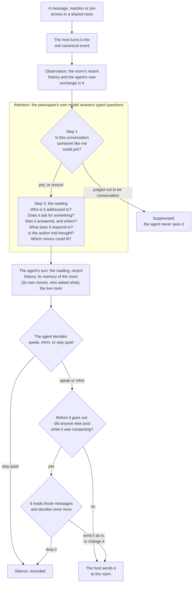

# Nunchi V2

Nunchi (눈치) is a library that helps an AI agent read the room socially and
take part in conversations through the channels people already use.

> **Architecture gap — under review.** The goal is for agents to use Nunchi's
> context and attention tools while their harness owns startup and turns, the
> agent controls its actions, and users choose their channels. Today's Claude
> Code and Codex integrations instead start agents, require Nunchi's Discord
> transport and route sending through Nunchi's turn code. Context CRUD and
> prompt configuration are also incomplete. This is a deviation from the
> library's goal, not a requirement users should have to accept.

The [architecture goal](AGENTS.md#architecture-goal-and-current-gap) is the
starting point for the current review. Core is meant to hold context and
history, make attention and social judgments, and expose configurable APIs
and tools. Replacement interfaces and implementation are still to be designed.

Agents take part socially, not only when they have something useful to add:
they may listen, react, joke, disagree, speak or stay silent. See
[Social behavior](AGENTS.md#social-behavior). The more detailed
[behavior draft](docs/behavior.md) follows the [draft-status guidance](AGENTS.md#draft-status).

## Current implementation

The diagrams below describe today's code, including the ownership under
review. They are not the target architecture or proof of live behavior.

## At a glance

### Current turn flow



Step 1 passes anything that might be conversation: a wrong suppression is
invisible, a wrong pass costs one turn. Step 2's reading is a
recommendation; the agent decides, and every visible move, a "mhm"
included, is its own.

### Available combinations

| Supplied integration | Channel connection | Agent execution |
|---|---|---|
| Claude Code | Nunchi's Discord transport only | Nunchi starts a dedicated Claude session and supplies its turns |
| Codex app-server | Nunchi's Discord transport only | Nunchi starts the app-server, manages its thread and supplies turns |
| Older Codex runner | Nunchi's Discord transport only | Nunchi invokes Codex with its tools disabled |
| Hermes plugin (parked) | Hermes's admitted Discord or Telegram messages | The plugin injects turns that bypass native thread, session and identity settings |
| Reference adapters | Generic JSONL, Discord, Matrix or Telegram | A plain model wrapper, not an integration with an existing agent harness |

These are not interchangeable combinations. Core accepts separate participant
and transport inputs, but the shipped entry points still impose the
dependencies above. The [harness contract](docs/harness-contract.md) and
[integration guides](#product-and-integration-documentation) describe them.

## How V2 works today

Nunchi is a portable pre-attention gate for turn-aware participants in shared
conversation. V2 has one path:

`native event -> canonical observation -> participant-bound attention (typed
questions) -> SUPPRESS, or one shared participant turn with the reading ->
host-owned transport`

Conversation events are observations, not reply obligations. Only the exact
participant's delegated attention model may make the social suppression
judgment. Deterministic host code owns identity, routing, context bounds,
scheduling, cancellation, receipts, authorization, and the single output or
effect commit point.

## Current state

V2 is on `main` and is partial: **merged, unverified**. Deterministic tests and
the clean-install lanes for Claude Code, Codex and the parked Hermes plugin
pass in CI. No surface has passed a live
real-room check since the shared core was replaced in
[PR #67](https://github.com/mentatzoe/nunchi/pull/67). V2 is not release-ready
or complete, and there is no V2 release tag. Combined acceptance is tracked in
[issue #41](https://github.com/mentatzoe/nunchi/issues/41).

`main` contains the shared core; the operator CLI, dashboard, and service
supervisor; packaging; generic/Discord/Matrix/Telegram reference adapters; the
shared Discord MCP transport; the incomplete Codex and Claude Code
integrations; and the parked Hermes plugin.

The shared core has one versioned participant protocol. A judgment that leans
to a "mhm" gives the agent a turn, and any "mhm" is the agent's own reaction;
Nunchi never reacts for it (step 7 of the plan removed Nunchi's own nod). The attention
model is chosen by configuration (`kind`), so the core names no agent host,
chat platform, or model vendor.

**Hermes.** Hermes has no supported path today. The old Hermes integration
was removed on 2026-10-11, for now. It patched Hermes at
runtime, which breaks the rule that an integration follows each harness's own
plugin rules and never patches or reimplements the harness
([`AGENTS.md`](AGENTS.md), One library, every harness). The Hermes plugin
([`integrations/hermes-plugin/README.md`](integrations/hermes-plugin/README.md))
is parked, not removed (2026-10-10): its code and CI lane stay, it has run
offline only, and there is no new Hermes work until it is unparked. CI runs
that plugin's turn conformance kit and tests inside a clean install of a pinned
stock Hermes, with the model scripted; these are installed-runtime checks, not
live ones. Historical Hermes evidence is not current proof.

**Codex.** `nunchi-codex-app-server-runner` runs a Codex participant in a
Discord room through `codex app-server`, with the user's own Codex model,
sandbox, tools, MCP servers and skills. It passes its tests against a real,
pinned `codex app-server`; it has not run in a real room. See
[`integrations/codex-app-server/README.md`](integrations/codex-app-server/README.md).
The older `nunchi-codex-room-runner` runs Codex with its tools turned off. It
stays until the app-server runner has passed live checks
([`integrations/codex/README.md`](integrations/codex/README.md)).

**Claude Code.** `nunchi-claude-code-room-runner` is a per-room gate. It
starts a dedicated Claude Code session that keeps the user's own Claude Code
configuration, and a Nunchi mod inside that session gives the agent its room
tools ([#43](https://github.com/mentatzoe/nunchi/issues/43)). Discord only.
Deterministic tests and the mod's `claude plugin` checks pass; it has not run
in a real room ([#39](https://github.com/mentatzoe/nunchi/issues/39)). See
[`integrations/claude-code/README.md`](integrations/claude-code/README.md).

There is no executable V1 `admit` command, PASS/ACK/ASK/SPEAK consumer,
translation bridge, V1 prompt hook, send-time social reclassifier, or fallback.

## Install and inspect

```sh
python3 -m venv .venv
.venv/bin/python -m pip install .
.venv/bin/nunchi probe
.venv/bin/nunchi-install probe
.venv/bin/nunchi setup \
  --profile vigil \
  --participant-id vigil \
  --actor-id discord:bot:9 \
  --display-name Vigil \
  --instructions 'Contribute carefully.' \
  --platform discord \
  --room-id 42 \
  --room-name delivery \
  --continuity-scope-id discord:channel:42 \
  --attention-model provider/attention-model \
  --participant-model provider/participant-model
.venv/bin/nunchi diagnose --profile vigil
.venv/bin/nunchi dashboard --profile vigil
```

Optional installed surfaces:

```sh
python3 -m pip install '.[discord]'
python3 -m pip install '.[mcp-discord]'
nunchi-channel --probe
nunchi-discord --probe
nunchi-matrix --probe
nunchi-telegram --probe
nunchi-codex-room-runner --probe
nunchi-claude-code-room-runner --probe
```

Hermes is not installed by the package. The parked Hermes plugin is installed
by hand, as its own README says
([`integrations/hermes-plugin/README.md`](integrations/hermes-plugin/README.md#install)).

The guided operator path creates and updates exact SHA-256 pins automatically;
operators do not calculate hashes or hand-write JSON. Credentials are named
only by trusted environment variable names in configuration; room payloads
cannot redirect models, identity, routes, policy, receipt destinations, or
output authority.

## Verify

```sh
python3 -m pip install '.[test]'
python3 -m unittest
python3 -m evals.verdict_suite.runner --list
python3 -m evals.verdict_suite.runner
python3 -m evals.behavior.run --dry-run
```

`python3 -m unittest` runs the offline suite under `tests/v2`: V2 schemas and
contracts, runtime, attention, authorization, scheduling, transport, operator
and services, reference adapters, Codex, Hermes, Claude Code, and the guard
that keeps the shared core agent- and provider-agnostic. Tests that need an
installed Hermes host skip without one. The suite does not prove a built
package or installed runtime; those require a fresh package build and isolated
installation. Whether an agent reads the room well needs behavioral evaluation
([#86](https://github.com/mentatzoe/nunchi/issues/86)); the deterministic
scenarios do not measure it. The approved specifications live in
[`docs/evaluations/scenes/`](docs/evaluations/scenes/README.md). Their saved
library packages are preparation artifacts, not protagonist runs or evidence
that a scene passed. Execution and scoring of this collection remain separate
evaluation-design work.

[`evals/behavior/`](evals/behavior/README.md) contains legacy fixtures;
`--dry-run` checks their plumbing offline, and the manual `behavior-eval`
workflow runs those fixtures against real models. Their move ranges and review
labels are not the approved collection's outcomes or approval status.
`tests/V1-REPLACEMENT.md` maps the removed V1 tests to their V2 coverage.

## Product and integration documentation

- [Architecture goal and current gap](AGENTS.md#architecture-goal-and-current-gap)
- [Portable V2 contract](docs/contracts/nunchi-v2.md)
- [Shared foundation and operator handoff](docs/v2-shared-foundation.md)
- [Install and operate](docs/INSTALL.md)
- [Platform interface and conformance](docs/platform-v2.md)
- [Harness contract](docs/harness-contract.md) and
  [harness guide](docs/harness-guide.md): current integration mechanisms under review
- [Reference adapters](docs/adapters.md)
- [Verification and evidence](docs/v2-verification.md)
- [Approved scene specifications](docs/evaluations/scenes/README.md) and
  [scene spec](docs/evaluations/scene-spec.md)
- [Scene design and revision skill](skills/nunchi-scenes/SKILL.md)

Source review, clean-wheel installation, configured probes, deterministic
tests, live provider evaluation, real-room evidence, integration, and release
are distinct claims. The verification record states exactly which have passed.
The maintainer decides release readiness from the intended behavior and
reproducible evidence. Historical acceptance plans do not settle the
architecture under review.
